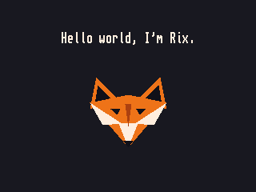

# hello-rix

A PlayStation hello world: one line of text and an orange fox drawn from flat
triangles, built with [psyqo](https://github.com/pcsx-redux/nugget/tree/main/psyqo).

    git clone --recursive https://github.com/rixnobis/hello-rix
    cd hello-rix && make

Needs a `mipsel-none-elf` toolchain. The result, `hello-rix.ps-exe`, runs on the
console or in [PCSX-Redux](https://github.com/grumpycoders/pcsx-redux).

